# Design Inspection & Redesign Blueprint: Tamal Sen Portfolio (`tamalsen.dev`)

> [!NOTE]
> This report documents the complete visual architecture, design system tokens, typography, component layouts, and micro-interactions of [Tamal Sen's Portfolio](https://tamalsen.dev/). High-resolution screenshots of every route and section were captured to serve as an exact redesign reference.

---

## 1. Visual Showcase: All Routes & Sections

### 1.1 Homepage Sections Walkthrough

````carousel

<!-- slide -->

<!-- slide -->

<!-- slide -->

<!-- slide -->

<!-- slide -->

<!-- slide -->

````

---

### 1.2 Dedicated Sub-Routes & Case Studies

````carousel

<!-- slide -->

<!-- slide -->

<!-- slide -->

<!-- slide -->

<!-- slide -->

<!-- slide -->

````

---

## 2. Design System & Style Breakdown

### 2.1 Color Palette Tokens

| Token Role | Hex Code | Visual Preview / Usage |
| :--- | :--- | :--- |
| **Canvas Background** | `#0f1016` / `#13141b` | Deep dark charcoal/slate, high contrast base |
| **Card Surface (Dark)** | `#17161a` / `#1e1e24` | Container background for cards, project frames |
| **Primary Brand Accent** | `#66d9ed` | Electric Cyan: logo `TamalSen`, active nav tabs, icons, links |
| **Magenta Chonky Accent** | `#DF058D` | Thick neon magenta underline / highlight (Software Dev, Email) |
| **Cobalt Blue Accent** | `#2C49D8` | Deep cobalt highlight underline (Frontend Dev, Testimonial card) |
| **Orange / Amber Accent**| `#FF6B2B` | Warm orange underline (Flutter Dev, point light glow) |
| **Violet Accent** | `#9440e8` / `#8b5cf6`| Purple buttons ("View Project"), experience cards, quotes |
| **Text Primary** | `#ffffff` | Pure white for titles, headings, active text |
| **Text Muted / Code** | `#838998` / `#abb8c3` | Gray for code comments, meta tags, dates, descriptions |
| **Accordion Purple** | `#2e1065` / `#3b0764` | Rich violet background for experience accordion bars |

---

### 2.2 Typography System

The design pairs a clean geometric Sans-serif with a technical Monospace font:

1. **Display & Headings: `Poppins`** (Weights: 400, 600, 700, 800, 900)
   - Used for: Hero Name (`TAMAL SEN`), Section Titles (`My Expertise`, `Work`, `Professional Experience`), Case Study Headers, Testimonial quotes.
   - Characterized by: Extra-bold weights, tight letter spacing (`-0.03em`), uppercase treatments on major titles.
2. **Technical & Monospace: `Roboto Mono`** (Weights: 400, 500, 700)
   - Used for: Brand logo suffix (`._`), Navigation items (`01 // home`), Section taglines, opening/closing code tags (`<h3>`, `</h3>`), project tags, dates, filter buttons.
   - Characterized by: Terminal aesthetic, lowercase comments syntax (`// work`).

---

## 3. Signature UI Motifs & Micro-Interactions

### 3.1 Monospace Numbered Navigation

The header navigation displays a tiny numbered index stacked directly above a code comment label:

```html
<nav class="flex items-center gap-8 font-mono text-sm">
  <a href="#hero" class="flex flex-col items-center group">
    <span class="text-[10px] text-gray-500">01</span>
    <span class="text-gray-300 group-hover:text-[#66d9ed] transition-colors">// home</span>
  </a>
  <a href="#expertise" class="flex flex-col items-center group">
    <span class="text-[10px] text-gray-500">02</span>
    <span class="text-cyan-400 font-semibold">// expertise</span>
  </a>
  <a href="#work" class="flex flex-col items-center group">
    <span class="text-[10px] text-gray-500">03</span>
    <span class="text-gray-300 group-hover:text-[#66d9ed] transition-colors">// work</span>
  </a>
  <a href="#experience" class="flex flex-col items-center group">
    <span class="text-[10px] text-gray-500">04</span>
    <span class="text-gray-300 group-hover:text-[#66d9ed] transition-colors">// experience</span>
  </a>
  <a href="#contact" class="flex flex-col items-center group">
    <span class="text-[10px] text-gray-500">05</span>
    <span class="text-gray-300 group-hover:text-[#66d9ed] transition-colors">// contact</span>
  </a>
</nav>
```

---

### 3.2 "Chonky Underline" Effect (Exact CSS Extracted from Source)

The colorful underlines under section headings and keywords use an absolute positioned pseudo-element that expands upward on hover:

```css
/* Base chonky underline */
.chonky-underline-magenta {
  position: relative;
  z-index: 0;
  color: #ffffff;
}

.chonky-underline-magenta::after {
  content: "";
  position: absolute;
  bottom: 13.5%;
  left: -1%;
  width: 104%;
  height: 0.3em;
  background: linear-gradient(65deg, #DF058D 0%, #DF058D 100%, transparent 100%);
  z-index: -1;
  transition: all 0.15s ease-in-out;
}

/* Expansion to full highlighter badge on hover */
.chonky-underline-magenta.has-hover-anim:hover::after {
  height: 1.05em;
  bottom: 2%;
}

/* Variants */
.chonky-underline-blue::after {
  background: linear-gradient(65deg, #2C49D8 0%, #2C49D8 100%, transparent 100%);
}
.chonky-underline-orange::after {
  background: linear-gradient(65deg, #FF6B2B 0%, #FF6B2B 100%, transparent 100%);
}
.chonky-underline-violet::after {
  background: linear-gradient(65deg, #9440e8 0%, #9440e8 100%, transparent 100%);
}
```

---

### 3.3 Code-Editor Watermark Backdrop

Behind the "My Expertise" cards sits a faint, syntax-highlighted HTML snippet watermark:

```html
<div class="relative py-20 overflow-hidden">
  <!-- Subtle code watermark background -->
  <pre class="absolute inset-0 select-none pointer-events-none opacity-[0.07] font-mono text-sm leading-relaxed text-pink-400 p-8">
&lt;html lang="en"&gt;
  &lt;head&gt;
    &lt;meta name="viewport" content="width=device-width, initial-scale=1.0"&gt;
    &lt;title&gt;Ashraf's Expertise & Architecture&lt;/title&gt;
  &lt;/head&gt;
  &lt;body&gt;
    &lt;h1&gt;Building intelligent LLM & ML Systems&lt;/h1&gt;
    &lt;p&gt;RAG pipelines, FastAPI backends, Deep Learning & Cloud Deployments&lt;/p&gt;
  &lt;/body&gt;
&lt;/html&gt;
  </pre>

  <!-- Content cards on top -->
  <div class="relative z-10 max-w-6xl mx-auto grid grid-cols-1 md:grid-cols-3 border border-gray-800 divide-y md:divide-y-0 md:divide-x divide-gray-800 bg-[#12131a]/80 backdrop-blur-sm">
    <!-- Card items -->
  </div>
</div>
```

---

### 3.4 Professional Experience Accordion

Each work history entry is rendered as a clean, rounded violet bar with company, role, dates, and an animated `+` expander icon:

```jsx
const ExperienceItem = ({ role, company, dates, description, isOpen, onToggle }) => (
  <div className="border border-purple-900/40 bg-[#1e1338] hover:bg-[#27184a] rounded-xl overflow-hidden transition-all duration-300 mb-3">
    <button 
      onClick={onToggle}
      className="w-full px-6 py-4 flex items-center justify-between text-left"
    >
      <div className="flex items-center gap-2">
        <span className="font-semibold text-white text-base md:text-lg">{role}</span>
        <span className="text-purple-300 font-medium">@ {company}</span>
      </div>
      <div className="flex items-center gap-4">
        <span className="font-mono text-xs text-purple-200/80">{dates}</span>
        <span className="text-purple-300 text-xl font-light transform transition-transform duration-200">
          {isOpen ? '−' : '+'}
        </span>
      </div>
    </button>
    {isOpen && (
      <div className="px-6 pb-5 pt-2 text-gray-300 font-sans text-sm leading-relaxed border-t border-purple-800/30">
        {description}
      </div>
    )}
  </div>
);
```

---

### 3.5 Contact Section & High-Contrast Testimonial Blocks

The contact area is split into two halves:
- **Left Column**: Clean freelance availability text, prominent email address with the signature neon underline, and vertical list of social networks.
- **Right Column**: Vibrant colored grid blocks (Violet, Royal Blue, Magenta) containing authentic client quotes with circular avatar badges and prominent quote symbols (`“`).

---

## 4. Component Mapping: Adapting Ashraf's Portfolio

Here is how Ashraf's current portfolio data can be mapped 1-to-1 to Tamal Sen's design structure:

```mermaid
graph TD
    A["Tamal Sen Design Pattern"] --> B["Ashraf's Content Adaptation"]
    
    A1["Hero: Software Engineer, Front End & App Developer"] --> B1["Hero: Ashraf - AI & ML Engineer / LLMOps Specialist"]
    A2["Expertise Card 1: Software Dev"] --> B2["Expertise Card 1: Machine Learning & Deep Learning (PyTorch, Scikit)"]
    A3["Expertise Card 2: Frontend Dev React, NextJS"] --> B3["Expertise Card 2: LLMs, RAG & Agents (LangChain, LlamaIndex, Vector DBs)"]
    A4["Expertise Card 3: Flutter Dev Android, iOS"] --> B4["Expertise Card 3: Cloud & MLOps (FastAPI, Docker, AWS, CI/CD)"]
    
    A5["Work Spotlight: Tryotel App"] --> B5["Work Spotlight: Ashraf's Flagship ML/RAG Project"]
    A6["Work Filter: All / Data Viz / Web Dev"] --> B6["Work Filter: All / GenAI & RAG / Machine Learning / Fullstack"]
    A7["Experience: Saimon Global, Upwork"] --> B7["Experience: Ashraf's Roles & Industry Experience in Accordion"]
    A8["Contact: Email + Testimonials"] --> B8["Contact: ashraf email + Client/Colleague endorsements"]
```



---

## 5. Next Steps for Implementation

1. **Typography Setup**: Add `@import url('https://fonts.googleapis.com/css2?family=Poppins:wght@400;600;700;800;900&family=Roboto+Mono:wght@400;500;700&display=swap');` to `index.css`.
2. **Add Chonky Underline Utilities**: Add the custom classes to `src/index.css` or Tailwind plugin.
3. **Refactor Navbar**: Update `src/components/Navbar/` to use the `01 // home` monospace stacked items and the glowing brand logo `Ashraf._`.
4. **Hero 3D Point Light / Cubes**: Use Three.js, Lucide icons, or high-fidelity Spline 3D geometry with floating point lights.
5. **Redesign Expertise & Work**: Structure into 3-column bordered cards with code watermarks, followed by the asymmetric mockup cards.
